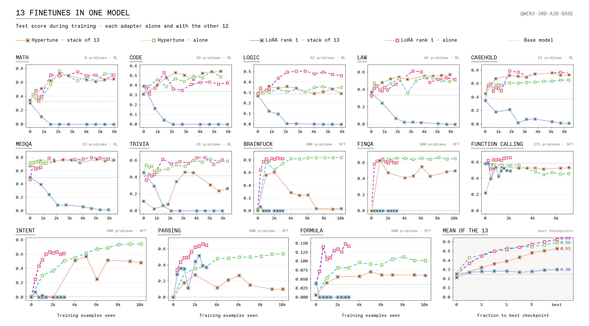
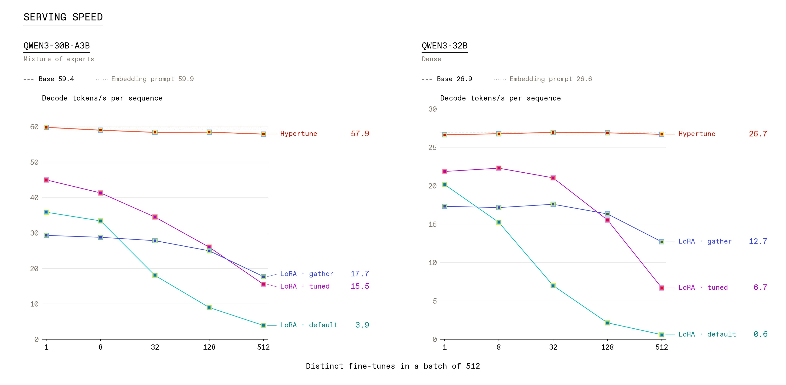

# Hypertune

Hypertune makes it economical to serve individually fine-tuned models at scale. Its adapter, a **soft prefill**,
is a set of trained key/value entries that sit in the attention cache of a frozen model. Because a soft prefill
lives entirely in the KV cache, a single batch can mix many different fine-tunes alongside requests with no fine-tune,
without LoRA's per-matrix overhead. To add it to an existing serving stack, prepend the soft prefill to the paged
KV blocks.

- **Serving.** Mixing LoRA fine-tunes in one batch is expensive. Each variant needs its own low-rank adapter at
  every matrix and is used for only a few tokens, which means many narrow matmuls and poor utilization. In a
  mixture-of-experts model it is worse: an adapter engages only when a token selects both a given fine-tune and a
  given expert. Hypertune decodes at the base model's speed however many distinct fine-tunes share the batch.
- **Co-residence.** Fine-tunes trained independently can be composed into one model without the regression that
  comes from adapters interfering. Hypertune trains its adapters to be co-resident.
- **Training.** A soft prefill can be trained with GRPO, SFT or any other first-order method. Cartridges, by
  contrast, compress a context through context distillation and need large amounts of synthetic self-study data.
- **Quality.** Hypertune matches LoRA in RL performance across 9 domains with 100x to 500x fewer parameters. We do
  not compare against full-parameter GRPO: under RL, LoRA already matches it, even at rank 1 ([LoRA Without
  Regret](https://thinkingmachines.ai/blog/lora/), Thinking Machines).

These gains suggest that discrete prompts leave a large share of in-context learning capacity unused. Soft
prefills may reach conditioning states that no token sequence can express, or their continuous parameterization
may make good conditioning states much easier to find by gradient descent, even when a discrete equivalent exists.

## Results

Thirteen tasks, one adapter per task. Each adapter is scored alone and loaded together with the adapters of the
other 12 tasks.

| Eval | Plain model | LoRA alone | Cartridge alone | Cartridge, 13 co-resident | LoRA, 13 co-resident |
|---|---|---|---|---|---|
| Contest math (AIME, HMMT, AMC) | 0.33 | 0.75 | 0.76 | 0.74 | 0.31 |
| MBPP (code) | 0.33 | 0.53 | 0.55 | 0.54 | 0.39 |
| Logic puzzles (Knights and Knaves, zebra) | 0.29 | 0.50 | 0.36 | 0.36 | 0.28 |
| MMLU-Pro law | 0.33 | 0.61 | 0.54 | 0.57 | 0.36 |
| CaseHOLD | 0.37 | 0.79 | 0.66 | 0.76 | 0.35 |
| MedQA-USMLE | 0.49 | 0.80 | 0.78 | 0.77 | 0.50 |
| TriviaQA (no context) | 0.42 | 0.63 | 0.62 | 0.46 | 0.46 |
| Synthetic eval (Brainfuck) | 0.02 | 0.83 | 0.84 | 0.61 | 0.06 |
| FinQA | 0.00 | 0.65 | 0.67 | 0.63 | 0.00 |
| Hermes function calling | 0.59 | 0.66 | 0.58 | 0.54 | 0.59 |
| Banking77 (intent) | 0.01 | 0.63 | 0.74 | 0.57 | 0.07 |
| TOPv2 (parsing) | 0.00 | 0.66 | 0.54 | 0.28 | 0.52 |
| SMolInstruct (name to formula) | 0.04 | 0.15 | 0.11 | 0.07 | 0.04 |
| **Mean of 13** | **0.25** | **0.63** | **0.60** | **0.53** | **0.30** |

Each score is the run's best checkpoint. Model: Qwen3-30B-A3B-Base, with 16-slot cartridges and rank-1 LoRAs.
Every point, sweep, split and per-problem grade behind the curves is in `experiments/coresidence/data/`.

Eval trajectories for the co-resident adapters in 13 domains. LoRA cannot handle co-residence, even when it is
trained to accommodate it.

The benchmark ran 512 sequences × 256 decode tokens on one NVIDIA B200 (180 GB) per engine with vLLM 0.33, and
does not count prefill. The LoRA runs used rank-1 adapters on every linear layer; "gather" is our reference
kernel. As the number of distinct adapters grows, default and tuned vLLM LoRA slow down while Hypertune stays
flat.

## Reproducing the plots

**Co-residence curves.** `experiments/tools/curves.py submit` runs the whole campaign on Slurm as one dependency
graph: banks, filler partners, learning-rate sweeps, training, and every snapshot scored alone and in the stack.
Steps skip themselves when done, and training resumes after preemption. Build the data once, then submit:

    export CURVES_ROOT=/path/every/node/sees CURVES_LIB=$PWD CURVES_VENV=/path/to/venv
    export CURVES_KNOWLEDGE=$CURVES_ROOT/knowledge D=$CURVES_ROOT/sft_data
    python experiments/tools/build_knowledge_set.py $CURVES_KNOWLEDGE
    mkdir -p $D/raw/finqa $D/raw/esolang
    for f in train dev test; do curl -sL -o $D/raw/finqa/$f.json https://raw.githubusercontent.com/czyssrs/FinQA/main/dataset/$f.json; done
    curl -sL -o $D/raw/esolang/test.jsonl https://huggingface.co/datasets/Lossfunk/Esolang-Bench/resolve/main/data/test.jsonl
    python -m envs.domains.funcall build --funcall-data $D/funcall --n-train 700 --n-dev 100 --n-test 275
    for d in finqa bf; do python -m envs.domains.$d build --$d-data $D/$d --raw $D/raw; done
    for d in intent parse formula; do python -m envs.domains.$d build --$d-data $D/$d; done
    for t in family_relationships letter_counting number_sorting sentence_reordering syllogism word_sorting; do
      python -m envs.domains.filler build --filler-task $t --filler-data $D/filler-$t --n-train 300 --n-dev 50 --n-test 100
    done
    python experiments/tools/build_neg_pool.py 300 $D/neg
    python experiments/tools/curves.py submit

Afterwards, `experiments/tools/export_curves.py DEST`
writes the data folder, and `experiments/coresidence/figure_tasks.py` and `figure_cost.py` draw the figures from its
`points.csv`. `curves.py`'s docstring lists the optional settings, including `reeval`, which scores finished runs
again without training.

**Serving speed.** `experiments/serving_speed/bench.py` times one configuration (`--kind base`, `lora` or `cart`)
and appends a JSON line to the results. `slurm_job.sh` runs a list of configurations over Slurm workers, and
`make_loras.py` makes the random LoRA adapters. Then:

    python experiments/serving_speed/plot.py experiments/serving_speed/results2.jsonl figure.png

## Install and test

    pip install -e ".[test]"          # Python 3.12; add ",vllm" to sample through vLLM
    python -m pytest tests -q

## Library map

| Path | What |
|---|---|
| `shared/cli.py` | the command line: `bank` (a task's problems and the plain model's rates), `train`, `eval`, `stack` |
| `shared/` | model loading, attaching adapters, sampling (HF or vLLM, `rollout.py`), scoring and banks (`eval.py`), training loop, vLLM KV patches (`kv_graph*.py`) |
| `adapters/` | `kv_prefix.py` (soft prefill / cartridge), `lora.py`, and full fine-tuning |
| `algorithms/` | `grpo.py`, `sft.py`, `offpolicy.py`, `distill.py` |
| `envs/` | Math environments (`mathgrade.py`), MBPP, knowledge QA, logic (`rg.py`); `envs/domains/` contains the SFT domains|
| `experiments/` | the cartridge recipe (`text_kv.py` start, `warm.py` warm start, `curve_eval.py`), `coresidence/` (curve data, figure scripts), `serving_speed/` (the benchmark), `contest_math/` (the contest problems) |
| `experiments/tools/` | `curves.py` (the 13-task campaign on Slurm), data builders, plotting, export and regrading |
| `tests/` | the test suite |

MIT licensed.
