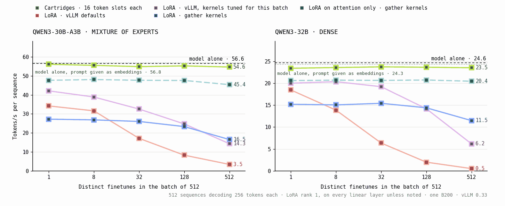

# Serving speed with many finetunes in one batch

One batch of 512 sequences, each decoding exactly 256 tokens. The only thing that changes is how many distinct
finetunes those 512 sequences use (1, 8, 32, 128, 512; sequence i uses finetune i mod N). Two models, one B200
each, vLLM 0.33.0: `Qwen/Qwen3-30B-A3B-Base` (mixture of experts) and `Qwen/Qwen3-32B` (dense). A finetune is
either a cartridge (16 token slots in the attention cache) or a LoRA.

Whole pass, LoRA at rank 1. The same without the prompt work: `figure_decode_only.png`.

## What it shows

- **Cartridges cost the same at 1 and at 512.** On the whole pass they run 1 to 5% below the model alone (their
  16 extra prompt positions); on decode alone they are within 2.5% of it, at every count.
- **LoRA pays before any mixing.** One unmerged rank-1 adapter on every linear layer, with vLLM's kernels tuned,
  runs 19% (dense) and 26% (MoE) below the model alone: two kernels per adapted layer on every step. (A single
  adapter can be merged into the weights at no cost; a mixed batch cannot.)
- **LoRA in vLLM falls as adapters multiply, and most of that is vLLM, not LoRA.** Three separate causes, each
  measured here:
  1. vLLM's expand kernel launches work per (token block, output block, active adapter). At default settings
     that is the whole curve. Tuning the block sizes for this batch recovers 1.1 to 11 times.
  2. The same is true of the kernel inside the MoE expert layers; its block size alone is worth 1.5 times at
     128 adapters.
  3. On every step the engine re-activates every adapter of the batch and rebuilds the adapter list for each
     (work that grows with the square of the adapter count). At 512 adapters that alone holds attention-only
     LoRA at 13 to 15 tokens/s whatever its kernels do; skipping it gives 45 (MoE) and 20 (dense).
- **With those three removed, attention-only LoRA is level too**, 15 to 20% below the model alone from 1 to
  512 adapters (gather kernels, re-activation skipped). vLLM's tuned kernels are closer than that while adapters
  are few: 9 to 14% below up to 32. LoRA on every linear layer still loses speed at 512 by gather (dense 14.4 to
  11.5, MoE 23.3 to 16.5).
- **Memory is where LoRA cannot follow.** vLLM allocates every adapter slot on the GPU: rank 16 on every linear
  layer does not start at 128 adapters on the MoE or at 512 on the dense model (183 GB card). 512 cartridges are
  0.8 GB (MoE) and 2.1 GB (dense).

So the claim this supports: with cartridges the number of distinct finetunes in a batch is free; with LoRA it is
not free in vLLM today, costs 9 to 26% even in the best cases built here, and is bounded by GPU memory. It does
not support "LoRA slows down with adapter count" as a property of LoRA: Punica (arXiv 2310.18547) batches
different adapters at about 2 ms per token, and the gather line here is level for attention-only adapters.

## Results

Three timed passes after one warm-up pass, the median; a configuration whose warm-up took over 90 s was timed
once. The median matters on the MoE, where one run in ten has a pass 16% off the other two. The same
configuration run again, on another node or an hour later, differs by 1% typically and 4% at most (the model
alone is listed once per run).

### Tokens/s per sequence, whole pass: 256 / seconds of generate

**MoE (Qwen3-30B-A3B).** Model alone: 56.2, 57.1, 56.4; with the prompt given as embeddings: 56.7, 56.9.

| Distinct finetunes | 1 | 8 | 32 | 128 | 512 |
|---|---|---|---|---|---|
| Cartridges, 16 slots each | 56.1 | 55.5 | 54.9 | 55.2 | 54.6 |
| LoRA rank 1, vLLM defaults | 34.2 | 31.6 | 17.2 | 8.31 | 3.46 |
| LoRA rank 1, vLLM kernels tuned | 42.1 | 38.9 | 32.6 | 24.7 | 14.3 |
| LoRA rank 1, gather kernels | 27.2 | 26.9 | 26.0 | 23.3 | 16.5 |
| LoRA rank 1, attention only, vLLM tuned | 51.0 | 50.8 | 48.6 | 42.2 | 15.2 |
| LoRA rank 1, attention only, gather | 47.6 | 48.0 | 47.7 | 47.6 | 45.4 |
| LoRA rank 16, vLLM defaults | 33.3 | 25.3 | 15.5 | out of memory | out of memory |
| LoRA rank 16, vLLM kernels tuned | 40.1 | 30.9 | 23.0 | out of memory | out of memory |
| LoRA rank 16, gather kernels | 15.7 | 15.4 | 14.7 | out of memory | out of memory |

**Dense (Qwen3-32B).** Model alone: 24.6, 24.6, 24.8; with the prompt given as embeddings: 23.8, 24.8.

| Distinct finetunes | 1 | 8 | 32 | 128 | 512 |
|---|---|---|---|---|---|
| Cartridges, 16 slots each | 23.4 | 23.6 | 23.7 | 23.6 | 23.5 |
| LoRA rank 1, vLLM defaults | 18.5 | 13.9 | 6.37 | 2.01 | 0.54 |
| LoRA rank 1, vLLM kernels tuned | 20.0 | 20.4 | 19.2 | 14.2 | 6.18 |
| LoRA rank 1, gather kernels | 15.2 | 15.1 | 15.4 | 14.4 | 11.5 |
| LoRA rank 1, attention only, vLLM tuned | 22.5 | 22.8 | 22.2 | 19.7 | 12.8 |
| LoRA rank 1, attention only, gather | 20.6 | 20.7 | 20.6 | 20.7 | 20.4 |
| LoRA rank 16, vLLM defaults | 18.1 | 13.4 | 6.15 | 1.95 | out of memory |
| LoRA rank 16, vLLM kernels tuned | 19.6 | 17.9 | 15.6 | 8.13 | out of memory |
| LoRA rank 16, gather kernels | 8.17 | 8.01 | 6.17 | out of memory | out of memory |

### Tokens/s per sequence, decode only: 255 / (pass - pass stopped at the first token)

**MoE (Qwen3-30B-A3B).** Model alone: 59.0, 60.0, 59.2; with the prompt given as embeddings: 59.7, 60.1.

| Distinct finetunes | 1 | 8 | 32 | 128 | 512 |
|---|---|---|---|---|---|
| Cartridges, 16 slots each | 59.8 | 59.1 | 58.4 | 58.5 | 57.9 |
| LoRA rank 1, vLLM defaults | 35.9 | 33.4 | 18.1 | 8.97 | 3.89 |
| LoRA rank 1, vLLM kernels tuned | 45.0 | 41.4 | 34.5 | 26.0 | 15.5 |
| LoRA rank 1, gather kernels | 29.4 | 28.9 | 27.9 | 24.9 | 17.7 |
| LoRA rank 1, attention only, vLLM tuned | 54.4 | 54.0 | 52.0 | 44.9 | 15.8 |
| LoRA rank 1, attention only, gather | 50.6 | 51.1 | 50.6 | 50.6 | 48.5 |
| LoRA rank 16, vLLM defaults | 35.1 | 26.5 | 21.1 | out of memory | out of memory |
| LoRA rank 16, vLLM kernels tuned | 42.8 | 32.5 | 24.1 | out of memory | out of memory |
| LoRA rank 16, gather kernels | 17.1 | 16.8 | 15.9 | out of memory | out of memory |

**Dense (Qwen3-32B).** Model alone: 26.9, 26.9, 27.1; with the prompt given as embeddings: 26.1, 27.2.

| Distinct finetunes | 1 | 8 | 32 | 128 | 512 |
|---|---|---|---|---|---|
| Cartridges, 16 slots each | 26.6 | 26.8 | 27.0 | 26.9 | 26.7 |
| LoRA rank 1, vLLM defaults | 20.2 | 15.2 | 7.05 | 2.23 | 0.60 |
| LoRA rank 1, vLLM kernels tuned | 21.9 | 22.3 | 21.1 | 15.6 | 6.74 |
| LoRA rank 1, gather kernels | 17.4 | 17.2 | 17.6 | 16.3 | 12.7 |
| LoRA rank 1, attention only, vLLM tuned | 24.6 | 25.0 | 24.3 | 21.6 | 13.8 |
| LoRA rank 1, attention only, gather | 23.0 | 23.1 | 23.1 | 23.2 | 22.8 |
| LoRA rank 16, vLLM defaults | 19.7 | 14.7 | 6.79 | 2.15 | out of memory |
| LoRA rank 16, vLLM kernels tuned | 21.4 | 19.6 | 17.2 | 8.86 | out of memory |
| LoRA rank 16, gather kernels | 9.06 | 8.87 | 6.66 | out of memory | out of memory |

"Out of memory" for the gather lines at rank 16 is the gather's own buffers (it copies each token's B rows; 12 GB
for one layer of the dense model during prompt processing), not vLLM's adapter slots. vLLM's own out-of-memory is
at engine start, in `create_lora_weights`.

## The lines

| Line | How |
|---|---|
| Model alone | `LLM(model, max_num_seqs=512)`; a second run with the prompt given as embeddings, as a cartridge's is |
| Cartridges | `shared.kv_graph` as `worker_extension_cls`: N cartridges of 16 slots in one table of N x 16 rows (`KV_GRAPH_ROWS`); each prompt carries the 16 placeholder rows of its cartridge before its last token |
| LoRA, vLLM defaults | `enable_lora=True, max_loras=N, max_lora_rank=R`, one `LoRARequest` per adapter. PEFT adapters on q/k/v/o and gate/up/down (`make_loras.py`). On the MoE the experts are PEFT `target_parameters`, which needs `enable_mixed_moe_lora_format=True` and `is_3d_lora_weight=True`; an adapter holding only expert weights changes the greedy output, so they are applied (`--kind check`) |
| LoRA, vLLM kernels tuned | the same engine with `VLLM_TUNED_CONFIG_FOLDER` and `VLLM_LORA_ENABLE_DUAL_STREAM=1`. The table for the shrink and expand kernels comes from `tune_kernels.py`: each kernel timed alone on this batch's decode step, per layer shape, rank and adapter count, over a grid of block sizes that goes past the ranges in vLLM's tuning notes (the fastest settings sat at their edge). For the MoE expert kernel the token-block size was swept on the real batch at 128 adapters: 16 gave 24.7 tokens/s, 32 23.9, 64 (the value vLLM falls back to) 16.5, 128 12.6. The line is the fastest tuned setting at each N |
| LoRA, gather kernels | `lora_gather.py`: vLLM's stacked adapter tensors and engine, with the two products done by gather (pick each token's A and B rows by adapter index, one batched product), the form vLLM uses off GPU. It also skips the per-step re-activation of an unchanged adapter set. Not vLLM's GPU path: a reference for a kernel whose work does not grow with the adapter count |
| attention only | the engine applies LoRA to q/k/v/o only (`lora_target_modules`); same adapter files |

The gather path was checked against vLLM's kernels inside the engine (`SS_GATHER_CHECK=1`: both run on the same
inputs): the LoRA contributions agree to 4 digits on every linear layer and on the expert gate/up layers, and to
0.3 to 2% on the expert down layers (bfloat16 rounding of contributions 100 times smaller).

All adapters and cartridges are untrained noise; speed does not depend on the weights.

## Kernel timings

LoRA kernel time per decode step of 512 tokens, linear layers only (ms): vLLM default / tuned / gather:

| Model, rank | 1 | 8 | 32 | 128 | 512 |
|---|---|---|---|---|---|
| moe, rank 1 | 8 / 7 / 29 | 9 / 7 / 29 | 17 / 7 / 29 | 52 / 10 / 29 | 198 / 21 / 29 |
| moe, rank 16 | 7 / 7 / 36 | 9 / 7 / 36 | 18 / 7 / 36 | 55 / 11 / 36 | 212 / 30 / 37 |
| dense, rank 1 | 24 / 20 / 78 | 42 / 20 / 78 | 113 / 25 / 78 | 410 / 55 / 78 | 1616 / 193 / 78 |
| dense, rank 16 | 25 / 21 / 201 | 42 / 20 / 201 | 117 / 33 / 202 | 427 / 85 / 204 | 1690 / 316 / 213 |

Tuned and default kernels grow with the adapter count; the gather form does not. It is slower than the tuned
kernels up to 128 adapters on the dense model and at every count on the MoE's attention layers (it is plain
tensor operations, and these are single-layer timings outside CUDA graphs: inside the engine it does better than
this table suggests, see the tables above). At default settings these timings account for the whole measured
slowdown: 410 ms a step at 128 adapters on the dense model, against 448 ms measured and 37 ms for the model alone. The MoE rows cover
attention only; its expert layers go through `fused_moe_lora`, which was tuned on the real batch.

## Protocol

- 512 prompts that differ by one number each; sampled at temperature 1 (vLLM's default) so the sequences differ
  from one another. With greedy decoding the plain model writes near-identical sequences, every token of a step
  goes to the same few experts, and the MoE runs at 88.6 tokens/s against 57: not a baseline.
- Every engine runs without prefix cache and without chunked prefill, which a cartridge engine cannot use (a
  cartridge's slots and the tokens before them must arrive in one forward). No line gets prompt work for free
  that another pays for.
- Whole pass: 256 / seconds of `llm.generate`. Decode only: 255 / (pass - the same batch stopped after its first
  token).
- Three nodes of one type (rows carry their host); other jobs ran on them.

## What a cartridge costs

- 16 more prompt positions per sequence, once, at prompt time: on the dense model the batch reaches its first
  token in 1.4 s against 0.9 s for the model alone, of a pass of 11 s (MoE: 0.29 s against 0.24 s, of 4.6 s).
- The engine restrictions above: no prefix cache, no chunked prefill, the prompt as embeddings.
- Its lookup. Once prompt embeddings are enabled vLLM hands the model embeddings on every decode step, so the
  path tests every token of every step for being a slot: `shared/kv_graph.py` hashes the token, searches the
  sorted keys and gathers the row. `tools/check_vllm_pos0.py` checks the path against the scorer on the real
  engine (0.660 greedy on 100 intent problems, mean |engine - scorer| 0.0537 nats).

## Scope

- One batch size (512), a prompt of about 30 tokens, one GPU per engine, untrained adapters; speed only.
- The tuned line is the best of the settings searched on this batch shape: the block sizes of the two linear-layer
  kernels and one block size of the expert kernel.

## Files

| File | What |
|---|---|
| `bench.py` | one configuration: engine, warm-up, timed passes, first-token pass; one JSON line appended to the results |
| `make_loras.py` | N random PEFT adapters for a model and rank |
| `tune_kernels.py` | times vLLM's LoRA kernels and the gather form on this batch, writes the tuned table and `kernel_times.json` |
| `tuned_configs.py` | the tuned table plus a block size for the MoE expert kernel |
| `lora_gather.py` | the gather LoRA path and its check against vLLM's kernels |
| `tables.py`, `plot.py` | the tables and the figure from the results |
| `slurm_job.sh`, `prep.sh` | the Slurm jobs the runs were made with (adapter generation, workers over a configuration list) |
| `results2.jsonl` | every run of this protocol, failed ones included (`status` ok, OOM or error; `variant` names the LoRA setup) |
| `kernel_times.json`, `tuned/` | the kernel timings and the tuned table used (linear-layer kernels from `tune_kernels.py`, expert kernel at block size 16) |
| `figure.png`, `figure_decode_only.png` | whole pass and decode only, rank 1 |

    python tables.py results2.jsonl kernel_times.json
    python plot.py results2.jsonl figure.png

`bench.py --kind cart` needs the library root on `PYTHONPATH`; `--lora-ops gather` needs this folder on it.
